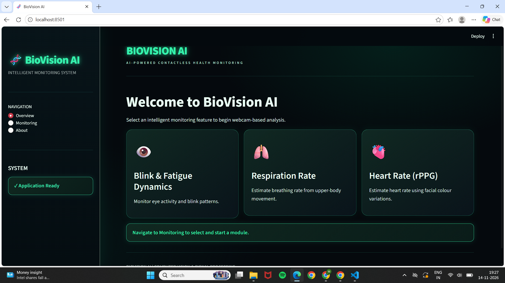
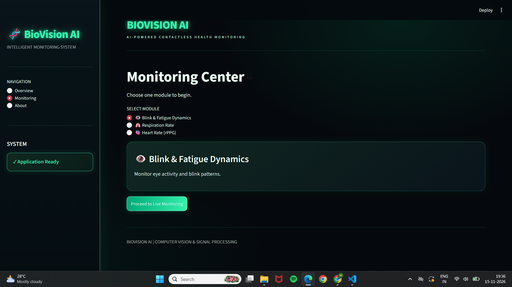
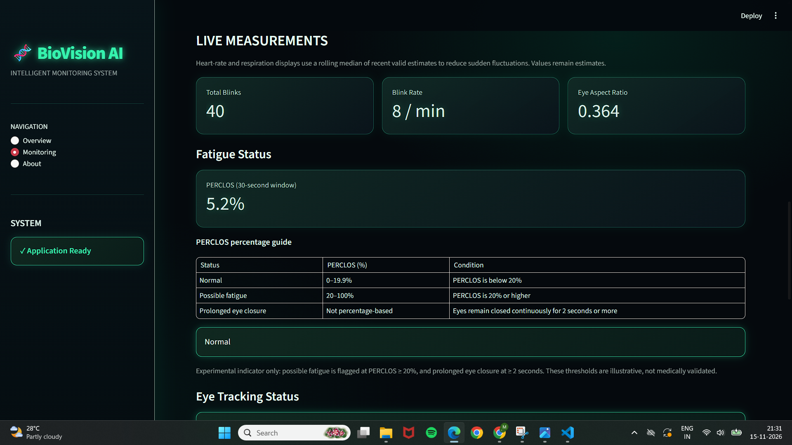
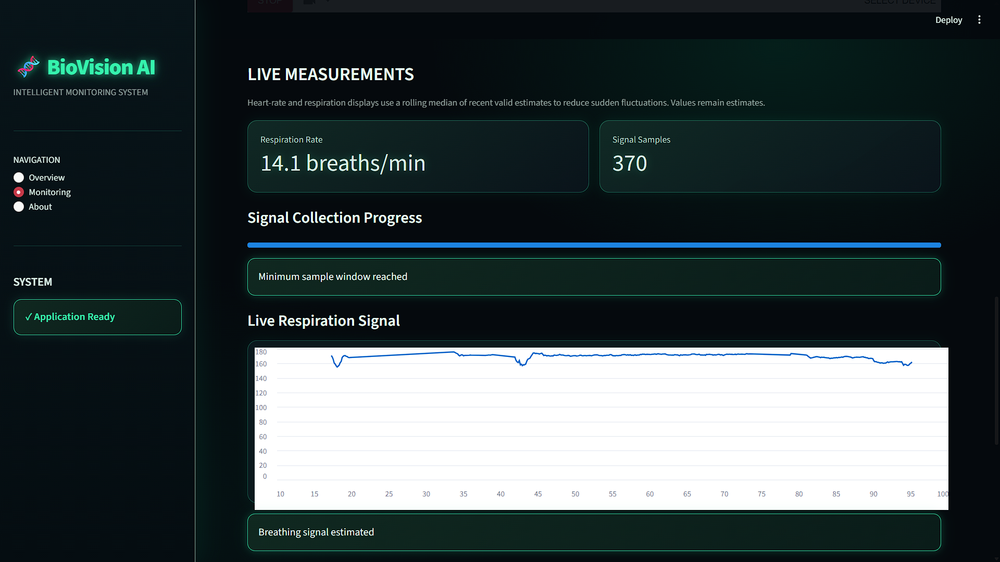
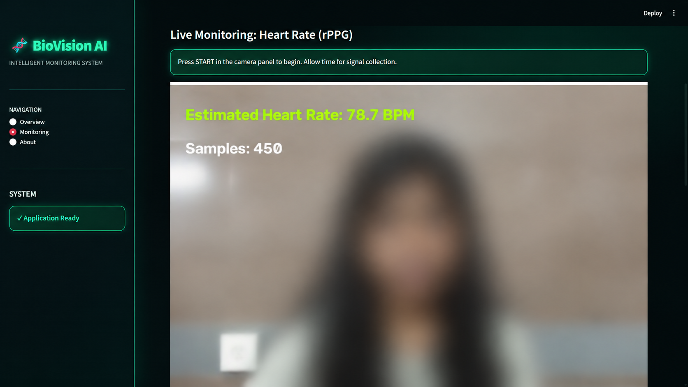
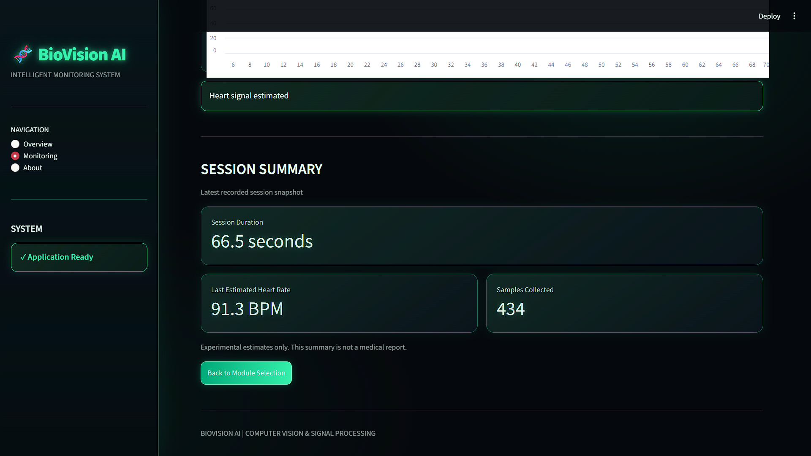

# 🧬 BioVision AI

## 🚀 Live Application

**Experience BioVision AI directly in your browser!**

🌐 **Live Demo:** https://biovision-ai-demo.streamlit.app/

💻 **Source Code:** https://github.com/MiracleSmilinRangel/BioVision-AI

No local installation is required to explore the deployed application.

### AI-Powered Contactless Health Monitoring System Using Computer Vision

BioVision AI is an experimental, webcam-based health monitoring application that explores contactless estimation of selected physiological parameters using Computer Vision and Digital Signal Processing techniques.

The system analyzes facial landmarks, upper-body visual signals, and facial colour variations to estimate blink patterns, respiration rate, and heart rate through an interactive Streamlit dashboard. It also includes an experimental fatigue-status indicator based on eye-closure patterns and PERCLOS estimation.

---

## 📌 Project Overview

BioVision AI consists of three independent monitoring modules:

1. **Blink & Fatigue Dynamics** – Detects eye activity and analyzes blink patterns using facial landmarks and Eye Aspect Ratio (EAR). It also estimates PERCLOS and displays fatigue-related status indicators.
2. **Respiration Rate Estimation** – Estimates breathing rate by analyzing visual signals extracted from the upper-body region.
3. **Heart Rate Estimation (rPPG)** – Estimates heart rate using facial colour variations captured through a webcam.

The application provides visualized signals, monitoring values, fatigue-status indicators, and session summaries through a real-time interactive dashboard.

---

## ✨ Key Features

### 👁️ 1. Blink & Fatigue Dynamics

- Real-time facial landmark detection using MediaPipe.
- Eye Aspect Ratio (EAR) calculation.
- Eye closure and blink detection.
- Blink counting and blink-rate monitoring.
- Live EAR signal visualization.
- PERCLOS estimation using a rolling 30-second sample window.
- Experimental fatigue-status classification.
- Live fatigue-status display.
- Session summary displaying blink activity and fatigue-related information.

**Fatigue Status Categories**

| Status | PERCLOS Percentage / Condition |
|---|---|
| Normal | Below 20% |
| Possible fatigue | 20% or higher |
| Prolonged eye closure | Continuous eye closure for 2 seconds or more |

*Note: Prolonged eye closure is determined by duration rather than PERCLOS percentage. The thresholds are illustrative project settings and are not clinically validated.*

### 🫁 2. Respiration Rate Estimation

- Upper-body region analysis.
- Grayscale image intensity extraction.
- Visual signal processing for breathing-pattern estimation.
- Experimental respiration-rate estimation.
- Live respiration signal visualization.

### 🫀 3. Heart Rate Estimation (rPPG)

- Facial landmark detection.
- Forehead Region of Interest (ROI) extraction.
- Green-channel signal analysis.
- Remote Photoplethysmography (rPPG)-based estimation.
- Live heart-rate display and signal visualization.

### 📊 4. Interactive Dashboard

- Dark-themed interface with neon-green styling.
- Separate monitoring modules.
- Webcam-based real-time analysis.
- Dynamic measurement displays.
- Signal graphs and session summaries.
- Live fatigue-status indicator and PERCLOS percentage guide.

---

## 🖥️ Application Screenshots

### 1. BioVision AI – Dashboard Overview



### 2. General Monitoring Dashboard



### 3. Blink Monitoring & Fatigue Status



### 4. Respiration Rate Monitoring



### 5. Heart Rate Monitoring (rPPG)

**Live Camera Monitoring**



**Heart Rate Dashboard and Session Summary**



---

## 🛠️ Technologies Used

| Technology | Purpose |
|---|---|
| Python | Core programming language |
| Streamlit | Interactive web dashboard |
| OpenCV | Image and video processing |
| MediaPipe | Facial and pose landmark detection |
| NumPy | Numerical computations |
| Pandas | Data handling |
| SciPy | Digital signal processing |
| Streamlit-WebRTC | Real-time webcam streaming |
| Streamlit-Autorefresh | Dashboard refresh functionality |
| PyAV | Video frame processing |

---

## 🧠 Concepts and Techniques

- Computer Vision
- Facial Landmark Detection
- Pose Estimation
- Eye Aspect Ratio (EAR)
- Blink Detection
- PERCLOS Estimation
- Fatigue Status Classification
- Remote Photoplethysmography (rPPG)
- Region of Interest (ROI) Extraction
- Green-Channel Signal Analysis
- Image Intensity Analysis
- Digital Signal Processing
- Real-Time Video Processing

---

## ⚙️ System Architecture

The application follows this general processing workflow:

1. **Video Acquisition:** Captures live video frames through a webcam.
2. **Landmark Detection:** MediaPipe identifies facial and body landmarks.
3. **Region Extraction:** Relevant facial and upper-body regions are selected.
4. **Signal Extraction:** Visual information is converted into numerical signals.
5. **Signal Processing:** Extracted signals are processed using NumPy and SciPy.
6. **Parameter Estimation:** Experimental blink, PERCLOS, respiration, and heart-rate values are calculated.
7. **Status Classification:** Eye-closure patterns are used to generate experimental fatigue-status indicators.
8. **Visualization:** Results are displayed through the Streamlit dashboard.

---

## 📂 Project Structure

```text
BioVision-AI/
│
├── models/
│   ├── face_landmarker.task
│   └── pose_landmarker_lite.task
│
├── screenshots/
│   ├── overview.png
│   ├── blink_monitoring.png
│   ├── monitoring.png
│   ├── respiration-monitoring.png
│   ├── heart-monitoring-1.png
│   └── heart-monitoring-2.png
│
├── biovision_live.py
├── requirements.txt
├── README.md
└── .gitignore
```

---

## 💻 System Requirements

- Python 3.10 or another version compatible with the installed dependencies.
- Webcam.
- Windows, Linux, or macOS.
- Internet connection for installing dependencies.
- Required MediaPipe model files.

---

## 🚀 Installation and Setup

Follow these steps to run BioVision AI on your local machine.

### Step 1: Clone the Repository

```bash
git clone https://github.com/MiracleSmilinRangel/BioVision-AI.git
```

### Step 2: Navigate to the Project Directory

```bash
cd BioVision-AI
```

### Step 3: Create a Virtual Environment

```bash
python -m venv venv
```

### Step 4: Activate the Virtual Environment

**For Windows:**

```bash
venv\Scripts\activate
```

**For Linux/macOS:**

```bash
source venv/bin/activate
```

### Step 5: Install Required Dependencies

```bash
pip install -r requirements.txt
```

### Step 6: Verify Model Files

Make sure the following files are available inside the `models/` directory:

- `face_landmarker.task`
- `pose_landmarker_lite.task`

### Step 7: Run the Application

```bash
streamlit run biovision_live.py
```

The application will launch in your default web browser.

---

## 📈 Applications

Potential educational and research applications include:

- Exploring contactless computer vision techniques.
- Understanding facial landmark-based blink detection.
- Studying experimental eye-closure and fatigue indicators.
- Learning PERCLOS-based estimation concepts.
- Studying visual signal extraction.
- Exploring remote photoplethysmography.
- Learning real-time video processing and signal visualization.

---

## ⚠️ Limitations and Disclaimer

BioVision AI is an experimental educational project developed to explore computer vision and signal processing techniques.

- Heart-rate and respiration-rate outputs are algorithmic estimates and may be affected by lighting, movement, camera quality, and environmental conditions.
- PERCLOS is approximated using the proportion of eye-closed samples in a rolling 30-second window. Its accuracy can be affected by variations in frame sampling and face detection.
- The fatigue-status thresholds are illustrative and have not been clinically validated.
- Blink patterns and eye-closure measurements alone cannot reliably determine fatigue.
- The system has not been clinically validated.
- The displayed values should not be considered medical measurements.
- The application must not be used for medical diagnosis, treatment, or healthcare decisions.

**BioVision AI is not a medical device. It is intended strictly for educational and experimental purposes.**

---

## 🔮 Future Enhancements

- Improve signal extraction and noise reduction.
- Improve PERCLOS calculation using actual elapsed eye-closure time.
- Evaluate estimation accuracy against suitable reference measurements.
- Improve performance under different lighting conditions.
- Enhance real-time signal visualization.
- Introduce session history and data analysis.
- Explore additional computer vision-based monitoring techniques.

---

## 👩‍💻 Author

**Miracle Smilin Rangel**

B.Tech – Artificial Intelligence and Data Science

GitHub: [@MiracleSmilinRangel](https://github.com/MiracleSmilinRangel)

Project Repository: [BioVision AI](https://github.com/MiracleSmilinRangel/BioVision-AI)

---

## ⭐ Acknowledgements

This project explores the practical application of Artificial Intelligence, Computer Vision, and Digital Signal Processing for experimental contactless monitoring.

Developed with the support of AI-assisted tools for implementation, debugging, and learning.

If you find this project interesting, consider giving the repository a ⭐!

---

<p align="center">
  <b>BioVision AI</b><br>
  Computer Vision | Artificial Intelligence | Signal Processing
</p>